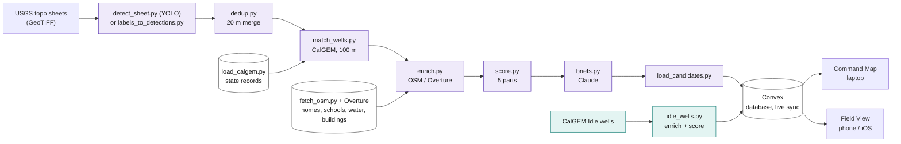
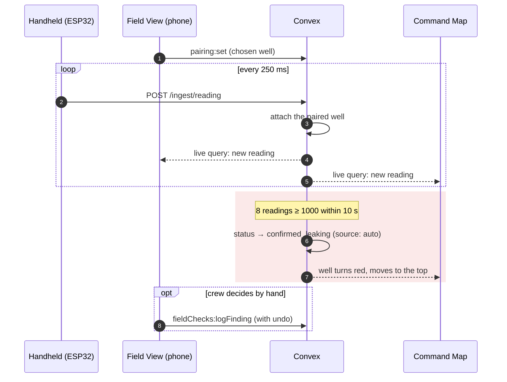
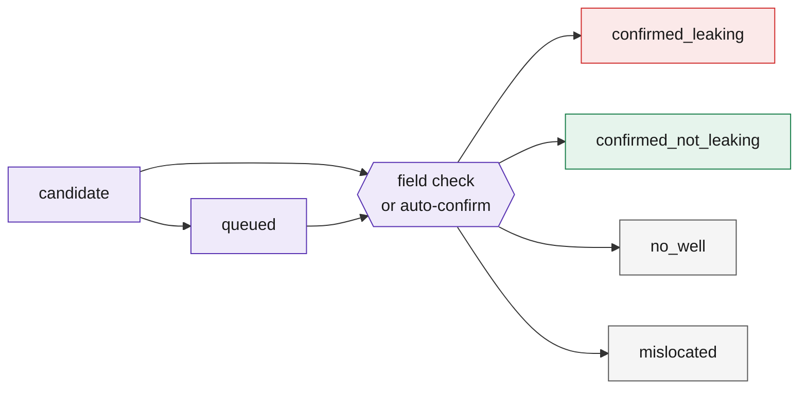

# Dowser

**Find the oil and gas wells nobody is watching, and send crews to the ones near people first.**


Dowser reads historical USGS topographic maps for oil and gas well symbols, checks each one against California's state well records (CalGEM), and ranks what's left for well-plugging crews by how close it is to homes, schools and water. A second list ranks wells the state *does* know about but that sit idle (not producing, not plugged) near people. Crews verify candidates in the field with a handheld that streams readings to a live map.

Built at Cal Hacks 13.0 (Oct 23–25, 2026) for Kern County, California.

**Live demo:** https://dowser-ten.vercel.app  (Command Map) · `/field` (Field View, also an iOS app on TestFlight)

> [!IMPORTANT]
> **About the demo sensor.** Flammable gas isn't allowed at the venue, so the handheld uses a **potentiometer (knob) to simulate a methane sensor reading**. Everything after the reading (live sync, pairing, auto-confirm, ranking, briefs) is the real system, and a gas sensor module can be wired to the same pin. The app shows a "Simulated sensor input" label whenever this is the case. The demo does not detect methane.

<!-- TODO: screenshot of the Command Map with the hero candidate open, e.g. docs/command-map.png -->
<!-- TODO: screenshot of Field View on a phone, e.g. docs/field-view.png -->

---

## Contents

| Overview | Build and run | Reference |
|---|---|---|
| [What it does](#what-it-does) | [Repository layout](#repository-layout) | [Data contracts](#data-contracts) |
| [Results so far](#results-so-far) | [Setup](#setup) | [Configuration](#configuration) |
| [How it works](#how-it-works) | [Running the data pipeline](#running-the-data-pipeline) | [Tests](#tests) |
| [Honesty, limitations and safety](#honesty-limitations-and-safety) | [The handheld (firmware)](#the-handheld-firmware) | [Where sponsor tools are used](#where-sponsor-tools-are-used) |
| [Team](#team) | | [Data sources, licenses and credits](#data-sources-licenses-and-credits) |

---

## What it does

| | Step | What happens |
|---|---|---|
| **1** | **Find candidate undocumented wells** | A YOLO detector (plus a hand-labeled set) finds well symbols on georeferenced USGS historical topo sheets. Each symbol is converted from map pixels to latitude and longitude, merged across map editions, and checked against every CalGEM well record. A symbol with **no state record within 100 m** becomes a candidate. |
| **2** | **Review them honestly** | Every candidate's map crop is reviewed by a person. Verified symbols rank at the top. Rejected ones (water wells, landmarks, buildings, text) stay visible in a collapsed "Rejected in review" section with the reason, and can never be sent to a crew. |
| **3** | **Rank by risk to people** | Each well gets a score from five parts: map confidence, distance from the nearest state record, closeness to homes, schools and buildings, closeness to water, and field confirmation. Sliders in the Command Map re-rank live. |
| **4** | **Rank idle wells the state already knows about** | A separate tab lists **CalGEM wells marked Idle within 250 m of a home or school**, ranked the same way, so crews get a useful list even where no undocumented wells are found. |
| **5** | **Explain each well in plain English** | Claude writes a short brief per well: summary, why it ranks where it does, what's uncertain, and the next step. Rules are enforced in code (see [Anthropic](#anthropic-claude)). |
| **6** | **Verify in the field, live** | In Field View a crew member picks a well and pairs the handheld. Readings stream to Convex and appear on both the phone and the Command Map within seconds. Sustained HIGH readings auto-confirm the well as leaking, which turns it red and moves it to #1. |

Field View mirrors the Command Map on the phone: both lists (not in state records, known to state: idle), a map with a legend and layer toggle, evidence crops, and the Claude brief for each well. Swipe from the left edge to go back.

---

## Results so far

All numbers below come from our own runs on Kern County data. They are reported only for the maps and area we checked.

| What | Number |
|---|---|
| CalGEM well records used for cross-checking (good locations) | 158,165 |
| Model detections (1954 Oildale and Oil Center sheets) | 3,116 boxes → 1,657 unique symbols |
| Model symbols within 100 m of a state record | 96% (median distance 15 m) |
| Model symbols with no record within 100 m | 64 |
| ...of those, verified in human review | **2** |
| ...rejected in review (not oil/gas well symbols) | 62 |
| Hand-labeled symbols (Oil Center 1954 + 1992, Oildale 1954) | 617 boxes → 537 unique wells |
| Hand-labeled wells within 100 m of a state record | 536 of 537 |
| Hand-labeled wells with no record within 100 m | 1, the same well as verified model candidate #1 (2 m apart) |
| CalGEM **Idle** wells in the study area | 19,916 |
| ...within 250 m of a home or school | **481** |
| ...within 250 m of a school | **76** |

**What this means**
- The map-to-coordinate conversion is accurate: almost every hand-labeled symbol lands on a known state well.
- Truly undocumented wells are rare on these sheets. The 2 verified candidates sit about 116 m and 197 m from the nearest record, so they could still be mislocated records. A field visit decides.
- Detector precision and recall on held-out tiles: **TODO: fill in from the ML report (Emir), and name the maps they cover. Measured on validation tiles only, not final test performance.**

---

## How it works

### Data pipeline

Two lanes feed one live database. Purple is the undocumented lane, teal is the idle-wells lane.



### Live field loop

The handheld knows nothing about wells. The phone pairs it to one, and Convex attaches every reading to that well and pushes it to both screens.



### Well statuses



Every change writes a `statusEvents` row with its source (`field`, `analyst`, `auto` or `pipeline`).

**Stack:** Python (GeoPandas, rasterio, pyproj, pandas) · YOLO / Roboflow · Convex (TypeScript) · Next.js 16 + React 19 + MapLibre GL · Capacitor (iOS) · Claude via the Anthropic API · ESP32 + SSD1306 OLED.

**Geospatial rules.** All distances are computed in California Albers (EPSG:3310). WGS84 latitude/longitude is stored for display. Each tile uses its own transform and records its map year.

---

## Repository layout

```
app/                Next.js app (Command Map at /, Field View at /field), Capacitor iOS wrapper
  src/app/          pages, globals.css, ux.css, cmdmap.css
  src/components/   Sidebar, DetailPanel, MapView, MapFilters, Sparkline, ...
  src/lib/types.ts  shared types, lanes, status colors
  public/evidence/  map crops shown as evidence (committed)
convex/             schema, queries/mutations, HTTP ingest, scoring, brief prompt
pipeline/           Python data pipeline (see below) and its tests
  review/           human review results (verified.csv, false_detections.csv)
  data/             large local data (NOT committed: CalGEM, OSM, detections, crops)
firmware/           ESP32 handheld sketch (placeholders for Wi-Fi and token)
tests/              Convex backend tests (vitest)
design-system/      design tokens and UI notes
```

---

## Setup

<details>
<summary><b>Prerequisites, install, Convex, environment files and running the app</b></summary>

### Prerequisites
- Node.js 20+ and npm
- Python 3.11 (we use a conda env named `dowser`)
- A Convex account (free) for your own dev deployment
- An Anthropic API key (only needed to generate briefs)
- Arduino IDE with the ESP32 board package (only for the handheld)

### 1. Install
```bash
git clone https://github.com/kunjalp/Dowser.git
cd Dowser
npm install                 # Convex + tests (repo root)
cd app && npm install && cd ..
```

### 2. Python environment
```bash
conda create -n dowser python=3.11 -y
conda activate dowser
pip install geopandas pandas pyproj rasterio shapely osmnx overturemaps anthropic pytest pillow
# only for running the detector on new sheets:
pip install ultralytics
```

### 3. Convex
```bash
npx convex dev              # creates/uses your own dev deployment and writes .env.local
npx convex env set INGEST_TOKEN <make-up-a-long-random-string>
```
`npx convex dev` keeps running and pushes backend changes automatically. Use `npx convex dev --once` to push once.

### 4. Environment files (never commit these)
Root `.env.local` (created by Convex, then add your key):
```
CONVEX_DEPLOYMENT=dev:<your-deployment>
CONVEX_URL=https://<your-deployment>.convex.cloud
ANTHROPIC_API_KEY=<your key>      # for pipeline/briefs.py
```
`app/.env.local`:
```
NEXT_PUBLIC_CONVEX_URL=https://<your-deployment>.convex.cloud
```
See `.env.example` and `app/.env.local.example`.

### 5. Run the app
```bash
cd app
npm run dev
```
Open http://localhost:3000 (Command Map) and http://localhost:3000/field (Field View).

To try the app without real data, load demo candidates (clearly marked as fake in the UI):
```bash
npx convex run seed:seedFakeCandidates
npx convex run seed:clearFake        # remove them again
```

</details>

---

## Running the data pipeline

Run everything from the **repo root** with `conda activate dowser`. Large inputs live in `pipeline/data/` and are not in git.

**Undocumented candidates in one command:**
```bash
python pipeline/run_undocumented.py
```
This combines the model detections with the hand-labeled set (`pipeline/data/detections_groundtruth.csv`), then runs dedup → match → enrich → score and prints the review summary (verified / rejected / not reviewed / conflicts).

<details>
<summary><b>One-time inputs</b> (CalGEM, OpenStreetMap, Overture)</summary>

```bash
# State well records (CalGEM)
python pipeline/load_calgem.py --csv pipeline/data/calgem_wells.csv --out pipeline/data/calgem

# Homes, schools and water from OpenStreetMap
python pipeline/fetch_osm.py

# Building footprints from Overture Maps
overturemaps download --bbox=-119.95,35.00,-118.85,35.75 -f geoparquet \
  --type=building -o pipeline/data/osm/buildings_overture.parquet
```

</details>

<details>
<summary><b>Detections</b> (detector or hand labels)</summary>

```bash
# Run the detector on georeferenced USGS sheets (from TopoView)
python pipeline/detect_sheet.py --weights best.pt --sheet "maps/*.tif"

# Or convert hand labels (YOLO .txt from Roboflow) to detections
python pipeline/labels_to_detections.py --sheet maps/<sheet>.tif --labels labels/
```
Both write `pipeline/data/detections.csv` plus evidence crops, and print a sanity check (what share of symbols land within 100 m of a known well).

</details>

<details>
<summary><b>Pipeline steps one at a time</b></summary>

```bash
python pipeline/dedup.py --detections pipeline/data/detections.csv pipeline/data/detections_groundtruth.csv
python pipeline/match_wells.py --detections pipeline/data/deduped.csv
python pipeline/enrich.py
python pipeline/score.py
```

</details>

<details>
<summary><b>Human review</b></summary>

```bash
python pipeline/review.py --help
```
Results live in `pipeline/review/verified.csv` and `pipeline/review/false_detections.csv` (by detection ID, with reason, reviewer and time). Rejected candidates are kept, shown last, and can't be queued.

</details>

<details>
<summary><b>Briefs and loading</b></summary>

```bash
python pipeline/briefs.py                       # Claude briefs for verified/unreviewed candidates (cached)
python pipeline/load_candidates.py --dry-run    # checks + writes candidates.json, sends nothing
python pipeline/load_candidates.py              # load into YOUR dev deployment
python pipeline/load_candidates.py --prod --reset-status --prune   # shared deployment (team only)
```
- `--reset-status` puts every loaded candidate back to `candidate` and logs each change. Without it, statuses set by people or the field are kept.
- `--prune` lists undocumented-lane candidates that aren't in this load, asks you to type `yes`, then deletes them. It never touches idle wells.

</details>

<details>
<summary><b>Idle wells near people</b></summary>

```bash
python pipeline/idle_wells.py --dry-run
python pipeline/idle_wells.py            # dev
python pipeline/idle_wells.py --prod     # shared deployment (team only)
```

</details>

**Other tools**
- `pipeline/impact.py`: pitch numbers into `pipeline/data/impact.json`.
- `pipeline/replay.py`: posts a recorded "knob up" reading sequence (marked `isReplay`), a fallback if the handheld or network fails.
- `pipeline/geotiff_to_overlay.py`: historical map overlay tiles for the Command Map.

---

## The handheld (firmware)

An ESP32 reads a potentiometer and posts a reading every 250 ms (four per second) to Convex over a phone hotspot.

**Behavior.** The OLED shows the reading, the state (**CLEAN** below 300, **ELEVATED** 300–999, **HIGH** 1000 and up), Wi-Fi status, and a visible error if posting fails, plus the label "SIMULATED SENSOR". The BOOT button toggles reading mode.

<details>
<summary><b>Wiring</b></summary>

| Part | ESP32 pin |
|---|---|
| Potentiometer middle leg (wiper) | GPIO 34 (ADC1, works with Wi-Fi on) |
| Potentiometer outer legs | 3V3 and GND |
| OLED SDA / SCL | GPIO 21 / GPIO 22 |
| OLED VCC / GND | 3V3 / GND |

</details>

<details>
<summary><b>Setup and posting contract</b></summary>

**Setup.** Open the sketch in `firmware/`, fill in the placeholders (Wi-Fi name and password, endpoint, token), select board "ESP32 Dev Module", and upload. Libraries: Adafruit SSD1306 and Adafruit GFX. **Never commit real Wi-Fi passwords or tokens.**

**Posting contract**
```
POST https://<deployment>.convex.site/ingest/reading
Header: X-Dowser-Token: <INGEST_TOKEN>
Body:   {"deviceId": "handheld-1", "value": 1250.0, "raw": 3413}
```
`201` = saved, `401` = wrong token, `404` = wrong URL. `GET /health` checks the endpoint. The board sends no well ID: the phone's pairing in Field View attaches readings to the chosen well (pairings expire after 30 minutes).

</details>

---

## Data contracts

<details>
<summary><b>Candidate, reading, statuses and main Convex functions</b></summary>

**Candidate** (pipeline → Convex → app)
`id, lat, lon, score, scoreParts {confidence, undocumented, people, water, field}, editionsSeen, nearestDocumentedId, nearestDocumentedDistM, distToHomeM, distToSchoolM, distToWaterM, buildingsNear250m, status, brief, evidenceImages [{year, url}], quadName, detectionId, source ("model" | "ground_truth" | "calgem_idle"), review {verdict, reason, reviewedBy, reviewedAt}, handLabeled, wellStatus, operator, apiNumber`

**Reading** (handheld → Convex)
`deviceId, value, raw, timestamp, candidateId (from pairing), lat, lon, locationSource, isReplay`

**Status values** (exactly these): `candidate, queued, confirmed_leaking, confirmed_not_leaking, no_well, mislocated`. Every change writes a `statusEvents` row with its source: `field`, `analyst`, `auto` or `pipeline`.

**Main Convex functions**
| Function | What it does |
|---|---|
| `candidates:ranked` | Ranked list; optional `lane` ("undocumented" or "idle"), status filter, custom weights |
| `candidates:get`, `candidates:eventsFor` | One candidate and its status history |
| `candidates:setStatus` | Change status (refuses to queue a rejected candidate) |
| `candidates:upsertBatch` | Pipeline loader (internal) |
| `readings:ingest` + HTTP `/ingest/reading` | Store a reading, auto-confirm on sustained HIGH |
| `pairing:set / clear / current` | Phone ↔ handheld pairing |
| `fieldChecks:logFinding` | Crew's finding from Field View (with undo) |

</details>

---

## Configuration

Kept as named constants, not buried in code:

| Setting | Value | Where |
|---|---|---|
| Cross-check radius (no record within) | 100 m | `pipeline/match_wells.py` |
| Dedup distance across editions | 20 m | `pipeline/dedup.py` |
| Proximity radius (idle lane, impact) | 250 m | `pipeline/idle_wells.py`, `impact.py` |
| Score weights | confidence 0.2, undocumented 0.2, people 0.3, water 0.1, field 0.2 | `convex/scoring.ts` (mirrored in `pipeline/score.py`) |
| HIGH threshold | 1000 | `AUTO_CONFIRM.threshold` in `convex/readings.ts`, firmware `HIGH` |
| Auto-confirm rule | 8 readings at or above HIGH within 10 s (about 2 s of holding the knob high) | `AUTO_CONFIRM` in `convex/readings.ts` |

---

## Tests

```bash
conda activate dowser
python -m pytest pipeline -q --ignore=pipeline/test_annotations_to_detections.py   # pipeline
npx vitest run                                                                       # Convex backend
cd app && npx tsc --noEmit                                                           # app types
```

---

## Where sponsor tools are used

### Convex
Convex is the whole backend: the database, every query and mutation, the HTTP endpoint the ESP32 posts to, and **live queries** that push changes over WebSocket to the Command Map and Field View with no refresh. A reading arriving from the handheld updates both screens within seconds, and auto-confirm runs server-side in the same mutation. Code: `convex/`.

### Anthropic (Claude)
Claude writes the field brief for each verified candidate (`pipeline/briefs.py`, prompt in `convex/briefPrompt.ts`). It's built for crews and state inspectors who need to decide quickly whether a site is worth a trip. Because a wrong brief could send a crew to the wrong place or overstate a risk, the rules are **checked in code, not just requested in the prompt**:
- 80–120 words, in four labeled parts (summary, why it ranks here, what's uncertain, next step)
- no number that isn't in the well's facts
- never says "confirmed" for a well that hasn't been confirmed in the field
- up to 2 retries with specific feedback, then a plain template fallback
- results are cached, and rejected candidates get no brief

<!-- Apify: add this section only if the Actor ships and is used in the pipeline.
### Apify
State well records are pulled by our Apify Actor (`apify/calgem-wells/`), which fetches Kern County records from CalGEM's public data and feeds `load_calgem.py`. A scheduled run re-pulls them daily and flags wells whose status changed (for example, newly Idle near a school). Run it with `python pipeline/fetch_calgem_apify.py`.
-->

---

## Honesty, limitations and safety

- **Simulated sensor.** The demo handheld uses a knob, not a gas sensor. It does not detect methane. A real module would need calibration, and this is a screening workflow, not a measurement instrument.
- **Candidates, not found wells.** "Not in state records" means no CalGEM record within 100 m. It could still be a mislocated record, which a field check can mark as `mislocated`.
- **Small area.** Results cover two quads in Kern County (Oildale and Oil Center) and the map editions listed above.
- **Human review.** 62 of 64 model candidates were rejected as lookalike symbols. They're kept and shown, not hidden.
- **Not production.** No accounts or auth, no regulatory-grade data, one region only.
- **Secrets.** No API keys, tokens or Wi-Fi passwords are committed. `.env.local` files are ignored by git. The firmware uses placeholders.

---

## Data sources, licenses and credits

| Source | Used for | License / terms |
|---|---|---|
| USGS Historical Topographic Map Collection (TopoView) | Well symbols on historical maps | Public domain (U.S. Government) |
| California Geologic Energy Management Division (CalGEM) | State well records, well status | Public records, State of California |
| OpenStreetMap contributors | Homes, schools, water | ODbL |
| Overture Maps Foundation | Building footprints | See Overture's per-theme licenses |
| Esri World Imagery | Satellite basemap | Esri terms of use (attribution shown on map) |

Research credit: this project builds on Berkeley Lab's work on finding undocumented orphan wells from historical maps.

---

## Team

| Person | Owns |
|---|---|
| Kunjal | Frontend (Command Map, Field View, iOS app), Convex backend, pitch |
| Ryann | Data pipeline, Convex data, review, briefs, README |
| Emir | Detector (YOLO), hand labels, accuracy |
| Murad | Hardware and firmware |
